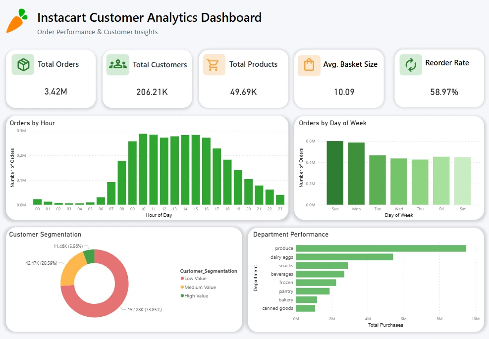

<h1></h1>

**Data analytics · Machine learning**

I build dashboards for business decisions and Python tools that give AI useful context about data. I’m a final-year Artificial Intelligence &amp; Data Science student and have worked as a Data Analyst Intern at **Trinetro Labs**.

## Selected work

### [Oribi](https://github.com/samhoon000/Oribi)

I created and maintain Oribi, an open-source Python library that profiles pandas DataFrames locally. It reports likely column roles, candidate keys, and data-quality warnings, then exports structured context for analysts and AI tools.

[PyPI package](https://pypi.org/project/oribi/) · [Contributing guide](https://github.com/samhoon000/Oribi/blob/main/CONTRIBUTING.md)

### [Instacart Customer Analytics](https://github.com/samhoon000/instacart-customer-analytics)

I used SQL and DuckDB to study reorder behavior and segment customers across **more than 3.4 million grocery orders**, then built two Power BI dashboards to explore the findings.

Preview the executive dashboard

 

### [Tamil Nadu Air Quality Analysis](https://github.com/samhoon000/tamilnadu-air-quality-analysis)

I used DuckDB and Power BI to analyze five years of air quality readings across eight Tamil Nadu cities and urban areas, comparing pollution trends and showing where monitoring data is sparse.

## Tools I work with

**Data analysis**

  
  
  
  
  

**Business intelligence**

  
  
  

**Machine learning and APIs**

  
  
  

## Connect

[Portfolio](https://samhoon.xyz/) · [GitHub repositories](https://github.com/samhoon000?tab=repositories) · [LinkedIn](https://www.linkedin.com/in/abdul-samhoon-0bb8b5330/) · [Email](mailto:bdlsmhn@gmail.com)

## GitHub activity

  

  

[View contributions on GitHub →](https://github.com/samhoon000#contribution-activity)
