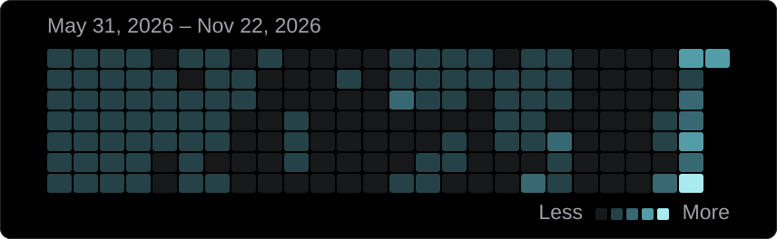

<h1></h1>

<em>“A good question tells you what to measure. A useful tool helps you ask the next one.”</em>

## About Me

I’m Abdul Samhoon, a final-year Artificial Intelligence & Data Science student. I previously worked as a Data Analyst Intern at **Trinetro Labs**, and I maintain **Oribi**, an open-source Python library.

I enjoy making sense of messy data and building practical tools that make technical work easier. My interests span data analytics, machine learning, AI, open-source software, and backend engineering.

## Featured Projects

### Oribi

Oribi inspects pandas DataFrames locally to infer dataset grain, column roles, and likely relationships, and flag data-quality issues. It gives developers and AI tools a structured snapshot of a dataset without having to share or repeatedly explain the raw data.

Python · pandas · [Repository](https://github.com/samhoon000/Oribi) · [PyPI](https://pypi.org/project/oribi/) · [Contributing guide](https://github.com/samhoon000/Oribi/blob/main/CONTRIBUTING.md)

### Instacart Customer Analytics

I analyzed **more than 3.4 million grocery orders** to understand purchasing patterns, segment customers, and explore what people reorder. Two Power BI dashboards make the findings explorable.

SQL · DuckDB · Power BI · [Repository](https://github.com/samhoon000/instacart-customer-analytics)

Preview the executive dashboard

 

### Tamil Nadu Air Quality Analysis

I compared five years of air-quality readings across eight Tamil Nadu cities and urban areas, using monitoring-station data to explore pollutant trends and gaps in coverage.

SQL · DuckDB · Power BI · [Repository](https://github.com/samhoon000/tamilnadu-air-quality-analysis)

### Sentinel — Cybersecurity Monitoring System

Sentinel monitors network traffic and combines multiple signals to flag suspicious activity in a real-time dashboard. Its intrusion detector uses a GATv2 graph neural network.

Python · FastAPI · PyTorch · Graph neural networks

## Tech Stack

### Languages & Data

  
  
  
  
  

### Analytics & Visualization

  
  
  
  

### Machine Learning & AI

  
  
  
  

### Backend & Development

  
  
  
  
  

### Databases & Cloud

  
  
  
  

## GitHub Activity

[View contribution activity on GitHub](https://github.com/samhoon000#contribution-activity)

## Connect

  
  
  
  

